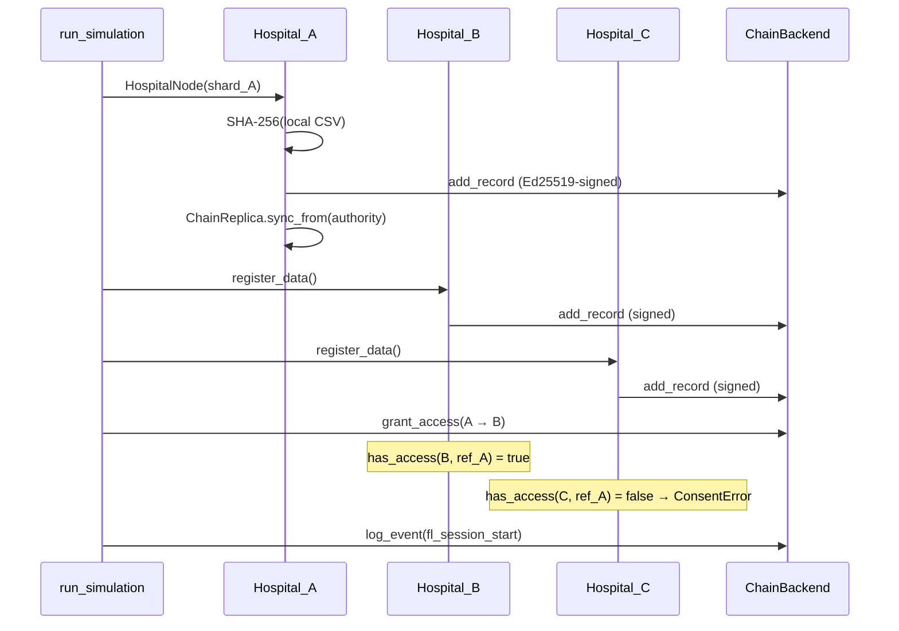
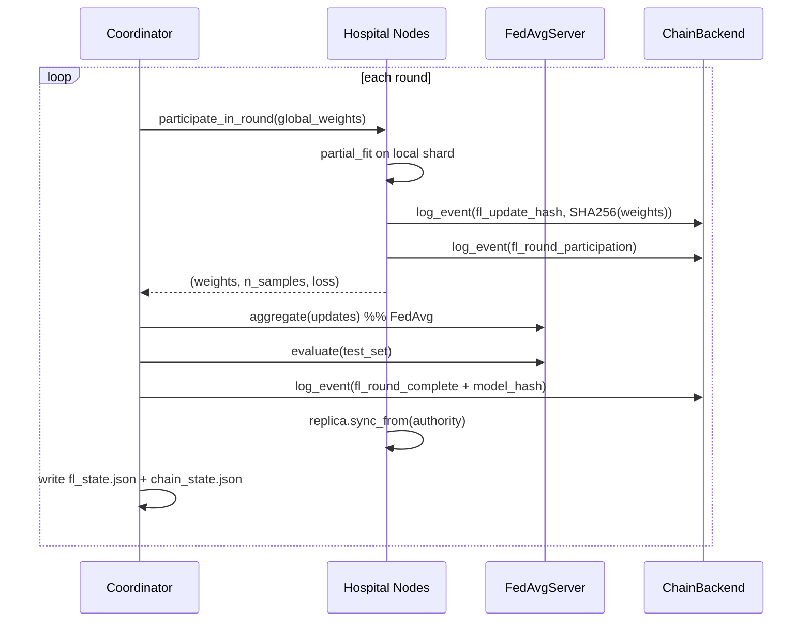

# System Architecture

**Blockchain Medical Record Sharing with Federated Learning**  
B.Tech Major Project — Phase-II Prototype (current codebase)

---

## 1. High-Level Overview

Two parallel concerns share one simulation loop:

| Layer | Role | Shared across hospitals | Stays private |
|---|---|---|---|
| **Permissioned blockchain** | Trust, consent, audit | Record hashes, grants, signed FL events, update hashes | Raw EHR / patient rows |
| **Federated Learning (FedAvg)** | Collaborative ML without pooling data | Model weights only | Local training shards |

```
┌──────────────────────── Streamlit UI ────────────────────────┐
│  streamlit_app.py  — run controls, charts, audit, experiments│
└─────────────────────────────┬────────────────────────────────┘
                              │ reads / writes via subprocess + JSON
┌──────────────────────── HTML Dashboard ──────────────────────┐
│  api.py :5000  →  dashboard/   GET /state  GET /chain        │
└─────────────────────────────┬────────────────────────────────┘
                              │ fl_state.json · chain_state.json
┌─────────────────────────────▼────────────────────────────────┐
│                 run_simulation.py  (coordinator)             │
│                                                              │
│   ┌─────────────┐  ┌─────────────┐  ┌─────────────┐          │
│   │ Hospital_A  │  │ Hospital_B  │  │ Hospital_C  │          │
│   │ FL client   │  │ FL client   │  │ FL client   │          │
│   │ ChainReplica│  │ ChainReplica│  │ ChainReplica│          │
│   │ local shard │  │ local shard │  │ local shard │          │
│   └──────┬──────┘  └──────┬──────┘  └──────┬──────┘          │
│          │ weights        │                │                 │
│          └────────────────┼────────────────┘                 │
│                           ▼                                  │
│                  FedAvgServer (aggregate + evaluate)         │
│                           │                                  │
│     signed hashes / grants / update hashes / FL audit        │
│                           ▼                                  │
│              ChainBackend  (inprocess | fabric mock)         │
└──────────────────────────────────────────────────────────────┘
```

---

## 2. Component Map

| Module | Path | Responsibility |
|---|---|---|
| Simulation orchestrator | `code/run_simulation.py` | Load dataset, split, register, consent demo, FL rounds, write state |
| Experiments | `code/run_experiments.py` | Centralized / local / FedAvg / poison / tamper baselines |
| Hospital node | `code/hospital_node.py` | FL client + consent gate + replica sync + update-hash commits |
| FL client | `code/fl_client.py` | Local `SGDClassifier` on hospital shard |
| FL server | `code/fl_server.py` | FedAvg aggregation, evaluation, global model hash |
| Data loaders | `code/datasets/` | PIMA, UCI Heart, MIMIC stub |
| Splits | `code/data_split.py` | IID equal shards or non-IID label/feature skew |
| Chain ABC | `code/chain/interface.py` | `ChainBackend` contract |
| Crypto | `code/chain/crypto.py` | Ed25519 keypairs / signatures |
| In-process ledger | `code/chain/inprocess.py` | Signed append-only chain (default) |
| Replicas | `code/chain/replica.py` | Per-hospital copies; reject invalid peers |
| Fabric gateway | `code/chain/fabric.py` | Mock ledger + SDK hooks stub |
| Factory | `code/chain/__init__.py` | `get_chain()` via `CHAIN_BACKEND` |
| FL adapters | `code/fl_adapters/` | Flower/PyTorch migration stub |
| HTML API | `code/api.py` | Serves dashboard + JSON routes |
| HTML UI | `code/dashboard/` | Live browser dashboard |
| Streamlit UI | `code/streamlit_app.py` + `code/ui/` | Control panel, charts, run/experiments |
| Self-check | `code/self_check.py` | Signatures, consent, splits, FedAvg, Fabric mock |

---

## 3. Data Flow

### 3.1 Registration, consent, replicas



### 3.2 Federated Learning round



### 3.3 On-chain vs off-chain

```
ON-CHAIN (ChainBackend)                 OFF-CHAIN (hospital / coordinator)
───────────────────────────────────     ──────────────────────────────────
• Genesis block                         • Dataset CSV shards (PIMA / Heart / stub)
• register_record + SHA-256 hash        • Local feature matrices / labels
• grant_access (consent)                • Local SGD models during training
• fl_session_start                      • Predictions, losses, accuracy curves
• fl_update_hash (per hospital)         • Streamlit / HTML dashboard assets
• fl_round_participation
• fl_round_complete + global model hash
• Ed25519 signatures + hash links
• Replica sync metadata (in fl_state)
```

---

## 4. Federated Learning Design

- **Algorithm**: FedAvg (McMahan et al., 2017)
- **Model**: Logistic regression — `sklearn.linear_model.SGDClassifier` (`log_loss`)
- **Clients**: Hospital_A / B / C
- **Splits**: `--split iid` (equal shards) or `noniid` (feature quantile skew + label bias)
- **Aggregation**: \( w_{global} = \sum_i \frac{n_i}{N} w_i \)
- **Evaluation**: Held-out ~10% test set at the server
- **Anchoring**: Per-hospital update hash + global model hash on-chain each round

```
Round r:
  for each hospital h:
      w_h ← train(local_data_h, start_from = w_global)
      chain.log(fl_update_hash, SHA256(w_h))
  w_global ← FedAvg({w_h, n_h})
  accuracy ← evaluate(w_global, test_set)
  chain.log(fl_round_complete, model_hash(w_global), accuracy, r)
  replicas.sync_from(authority)
```

Optional future path: `code/fl_adapters/flower_pytorch_stub.py` documents swapping sklearn → Flower + PyTorch without changing the hospital/server orchestration shape.

---

## 5. Blockchain Design

Stable API (`ChainBackend`) so FL code never imports a concrete ledger:

| Method | Purpose |
|---|---|
| `add_record(hospital, hash, metadata)` | Register dataset fingerprint |
| `grant_access(from, to, record_ref)` | Consent / access grant |
| `has_access(requester, record_ref)` | Enforce consent before use |
| `log_event(type, actor, details)` | FL / session / update-hash audit |
| `verify_chain()` | Hash links + Ed25519 signature checks |
| `to_dict()` | Serialize for `chain_state.json` |
| `sync_status()` | Optional dashboard metadata |

**Block fields:** `index`, `timestamp`, `data`, `previous_hash`, `hash`, `signer_id`, `public_key`, `signature`

**Backends**

| Backend | Env | Behavior |
|---|---|---|
| `InProcessChain` | `CHAIN_BACKEND=inprocess` (default) | Local signed append-only chain |
| `FabricGateway` mock | `CHAIN_BACKEND=fabric`, `FABRIC_MODE=mock` | Same interface; in-memory Fabric-like submit/evaluate |
| `FabricGateway` SDK | `FABRIC_MODE=sdk` | Stub — real Hyperledger Gateway hooks TODO |

**Replicas:** each `HospitalNode` keeps a `ChainReplica`. Sync copies from the authority chain; unsigned or hash-broken peers are rejected.

---

## 6. Runtime & UI Architecture

### 6.1 HTML dashboard path

```
Terminal 1                         Terminal 2
──────────                         ──────────
python api.py                      python run_simulation.py [...]
     │                                  │
     │ serves                           │ writes each round
     ▼                                  ▼
dashboard/  ←── GET / ──┐         fl_state.json
                        │         chain_state.json
GET /state  ←───────────┼─────────┘
GET /chain  ←───────────┘
     │
     ▼
Browser @ http://localhost:5000
```

### 6.2 Streamlit path

```
streamlit run streamlit_app.py
        │
        ├─ Overview / Hospitals / Metrics / Audit  ← read JSON state
        ├─ Run Simulation  ← subprocess: run_simulation.py (+ flags)
        └─ Experiments     ← subprocess: run_experiments.py (if present)
```

Both UIs are complementary; neither replaces the other.

---

## 7. Project File Layout

```
major project/
├── ARCHITECTURE.md              ← this document
├── README.md
├── ROADMAP.md
├── project_understanding.md
└── code/
    ├── streamlit_app.py
    ├── ui/
    │   ├── state.py             # load/normalize fl_state / chain_state
    │   └── runner.py            # subprocess simulation + flag discovery
    ├── .streamlit/config.toml
    ├── api.py
    ├── dashboard/
    ├── run_simulation.py
    ├── run_experiments.py
    ├── hospital_node.py
    ├── fl_client.py
    ├── fl_server.py
    ├── data_split.py
    ├── datasets/
    │   ├── pima.py
    │   ├── heart.py
    │   └── mimic.py
    ├── chain/
    │   ├── interface.py
    │   ├── crypto.py
    │   ├── inprocess.py
    │   ├── replica.py
    │   └── fabric.py
    ├── fl_adapters/
    ├── blockchain.py            # thin re-export
    ├── self_check.py
    ├── requirements.txt
    ├── data/
    ├── fl_state.json
    ├── chain_state.json
    └── experiment_results.json
```

---

## 8. Security Model (prototype)

| Threat | Prototype handling | Future upgrade |
|---|---|---|
| Tampered audit trail | Hash links + Ed25519; replicas reject bad peers | Fabric peers + endorsement policy |
| Raw data leakage | Only hashes / weights leave the node | Secure aggregation (Bonawitz 2017) |
| Unlogged access | `has_access` / `use_record_ref` consent gate | Patient consent chaincode |
| Model poisoning | Measured in `run_experiments.py` | Robust / trimmed aggregation |

**Hard constraint:** no live hospital PHI — public PIMA / UCI Heart or synthetic MIMIC-shaped data only.

---

## 9. Experiments Layer

`run_experiments.py` produces comparable metrics (accuracy / AUC where applicable):

1. Centralized SGD (pooled upper bound)
2. Local-only (average of isolated hospital models)
3. FedAvg (current path)
4. Label-flip and weight-poison attacks (accuracy drop)
5. Chain tamper — asserts `verify_chain()` fails

Results: console table + `experiment_results.json` (also shown in Streamlit Experiments tab).

---

## 10. Roadmap status

See [`ROADMAP.md`](ROADMAP.md).

| Step | Status |
|---|---|
| 1 Abstract chain backends | **Done** |
| 2 Signed blocks, replicas, update hashes | **Done** |
| 3 Consent + non-IID splits | **Done** |
| 4 Datasets (PIMA / Heart / MIMIC) | **Partial** — MIMIC stub |
| 5 Baselines + attacks | **Done** |
| 6 Real Fabric + Flower/PyTorch | **Partial** — Fabric mock Done; SDK / Flower stub |

| Current | Remaining target |
|---|---|
| Fabric mock | Live Fabric Gateway SDK + chaincode |
| sklearn SGD | Optional Flower + PyTorch |
| MIMIC synthetic | Credentialed PhysioNet extract (manual) |
