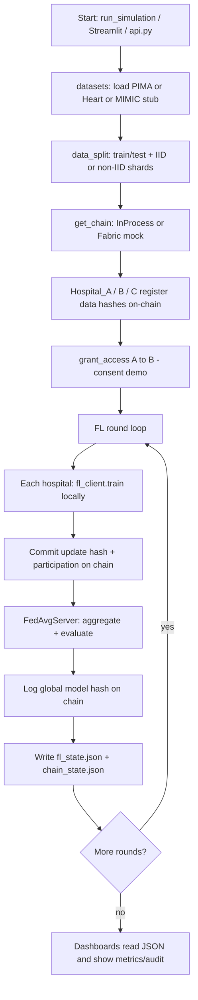

# Full project walkthrough

## What this project is

Hospitals want to **train a shared medical ML model** and keep an **audit trail of access**, but they **must not pool raw patient rows**.

Your prototype solves that with two layers:

1. **Federated Learning (FedAvg)** — each hospital trains locally; only model weights are shared  
2. **Permissioned blockchain** — only hashes, consent grants, and FL audit events go on-chain (signed)

Public clinical data only (PIMA / UCI Heart / synthetic MIMIC stub) — not live hospital PHI.

---


## End-to-end workflow



**In one sentence:** load data → split across 3 hospitals → register hashes → train locally each round → FedAvg → log everything on a signed chain → UIs read the JSON.

---

## Runtime: how you actually run it

| What you run | Role |
|---|---|
| `python run_simulation.py` | The “brain” — runs the full FL + chain story |
| `python api.py` | Serves HTML dashboard at `http://localhost:5000` |
| `streamlit run streamlit_app.py` | Interactive UI: start sim, charts, audit, experiments |
| `python run_experiments.py` | Baselines + attack tests → `experiment_results.json` |
| `python self_check.py` | Quick sanity asserts |

Typical demo: start `api.py` **or** Streamlit, then run the simulation (Streamlit can start it for you).

---

## File-by-file: what each piece does

### Entry points / orchestrators

| File | Job |
|---|---|
| **`run_simulation.py`** | Main workflow: load dataset → split → create hospitals → register → consent → FL rounds → write `fl_state.json` / `chain_state.json` |
| **`run_experiments.py`** | Compare centralized vs local vs FedAvg; label-flip / weight-poison; tamper the chain and prove `verify_chain()` fails |
| **`api.py`** | Tiny HTTP server: `/` dashboard, `/state` → FL JSON, `/chain` → blockchain JSON |
| **`streamlit_app.py`** | Full control panel (tabs: Overview, Run, Hospitals, Metrics, Audit, Experiments) |
| **`self_check.py`** | Unit-style checks without a test framework |

### Federated Learning core

| File | Job |
|---|---|
| **`fl_client.py`** | One hospital’s local trainer (`SGDClassifier`). Input: global weights. Output: local weights + sample count + loss. Never sends raw rows. |
| **`fl_server.py`** | **FedAvg**: weighted average of client weights; evaluates accuracy on held-out test set; hashes global model |
| **`hospital_node.py`** | Glue for one hospital: FL client + chain logging + **consent gate** + **replica sync** + **update-hash** commits |
| **`data_split.py`** | Hold-out test set; shard train data **IID** (equal) or **non-IID** (label/feature skew so hospitals look different) |
| **`fl_adapters/`** | Stub docs for later Flower + PyTorch swap (not used in the default demo) |

### Blockchain (`chain/`)

| File | Job |
|---|---|
| **`chain/interface.py`** | Abstract API: `add_record`, `grant_access`, `has_access`, `log_event`, `verify_chain`, `to_dict` |
| **`chain/crypto.py`** | Ed25519 keypairs / signatures for hospitals |
| **`chain/inprocess.py`** | Default local signed append-only ledger (your “blockchain” for demos) |
| **`chain/replica.py`** | Each hospital’s copy of the chain; rejects bad/unsigned blocks |
| **`chain/fabric.py`** | Fabric **mock** (same API); real SDK path is stubbed |
| **`chain/__init__.py`** | `get_chain()` factory — picks backend from `CHAIN_BACKEND` |
| **`blockchain.py`** | Thin re-export so old `from blockchain import …` still works |

**On-chain (allowed):** dataset hash, access grants, FL participation, update hashes, model hash  
**Off-chain (private):** actual patient feature rows at each hospital

### Datasets

| File | Job |
|---|---|
| **`datasets/__init__.py`** | `load_dataset("pima"|"heart"|"mimic")` |
| **`datasets/pima.py`** | PIMA diabetes (default; auto-download if missing) |
| **`datasets/heart.py`** | UCI Heart multi-center style tables |
| **`datasets/mimic.py`** | Tiny **synthetic** MIMIC-shaped sample (no PhysioNet download) |
| **`data/`** | Stored CSVs / center files used by those loaders |

### UIs

| File | Job |
|---|---|
| **`dashboard/index.html` + `app.js` + `style.css`** | Browser dashboard; polls `/state` and `/chain` |
| **`ui/state.py`** | Streamlit helpers: load/normalize JSON state |
| **`ui/runner.py`** | Streamlit starts `run_simulation.py` as a subprocess |
| **`.streamlit/config.toml`** | Streamlit theme |

### Generated state (written while running)

| File | Job |
|---|---|
| **`fl_state.json`** | Live FL status: hospitals, rounds, accuracy, consent/replica meta |
| **`chain_state.json`** | Full block list for the audit UI |
| **`experiment_results.json`** | Output of `run_experiments.py` |

### Docs / config

| File | Job |
|---|---|
| **`README.md`** | How to install and run |
| **`ARCHITECTURE.md`** | Design diagrams and component map |
| **`ROADMAP.md`** | What steps are Done / Partial / Stub |
| **`project_understanding.md`** | Phase-I problem/solution notes |
| **`PROJECT_GUIDE.md`** | This file — full walkthrough of files and workflow |
| **`requirements.txt`** | Python dependencies |

---

## One FL round (closer look)

For each round `r`:

1. **Hospital_A/B/C** call `participate_in_round(r, global_weights)`  
2. Local `fl_client.train` does one SGD pass on **only that hospital’s shard**  
3. Hospital logs `fl_round_participation` + `fl_update_hash` (SHA-256 of its weights) on the chain and syncs its replica  
4. **FedAvgServer** averages weights (weighted by number of samples)  
5. Server evaluates on the **shared test set** (accuracy / loss)  
6. Coordinator logs `fl_round_complete` + global model hash  
7. State JSON files update → dashboards refresh  

Raw CSV rows never leave the hospital node.

---

## Consent workflow (why blockchain matters here)

1. A registers its dataset → on-chain `register_record` with hash  
2. Simulation calls `grant_access(A → B)`  
3. B can `use_record_ref(A’s hash)` → allowed  
4. C tries the same without a grant → **`ConsentError`**  

So the chain is not storing medical files; it stores **who was allowed to reference what**, plus FL audit.

---

## Mental model of folders

```
code/
├── run_*.py, api.py, streamlit_app.py   ← you start here
├── fl_*.py, hospital_node.py, data_split.py  ← FL logic
├── chain/                               ← trust / audit / signatures
├── datasets/ + data/                    ← what gets trained on
├── dashboard/ + ui/                     ← what you see
└── *_state.json                         ← live bridge between sim and UI
```

---

## What to say in a viva (short)

> “Three hospitals keep data locally. They train with FedAvg and share only weights. Dataset fingerprints, consent grants, and model-update hashes are written to a signed permissioned chain. Dashboards poll JSON state. We evaluate with public PIMA/Heart data, non-IID splits, and attack/tamper experiments.”
